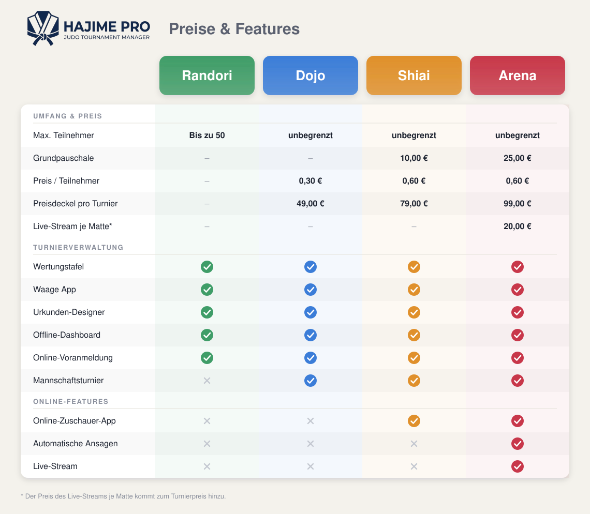

# Hajime Pro

Turnierverwaltung für Judo-Wettkämpfe nach den Regeln des Deutschen Judo-Bundes (DJB): von der Anmeldung über Auslosung, Matten- und Zeitplanung und Live-Steuerung bis zur Siegerliste und den Urkunden. Kein Scoring-Tool (keine Ippon/Waza-ari/Shido-Erfassung), sondern reine Wettkampf-Organisation.

## Betriebsmodi

Pro Halle gibt es **genau einen Server**, alle Clients (Notebooks, Handys, Tablets) hängen an ihm. Sechs typische Aufbauten, vom einzelnen Notebook bis zum Cluster mit Internet. Blau = Server, grün = Client-Gerät, grau = Netzwerk, Drucker, Internet, Cloud.

### 1 Ein Notebook für alles


Ein Rechner, ein Drucker, kein Netzwerk nötig. Die Pläne kommen auf Papier aus dem Drucker.

### 2 Notebook als Server im WLAN


Matten und Waage bekommen eigene Geräte; bei WLAN-Abbruch arbeiten die Clients lokal weiter und gleichen danach ab.

### 3 Durchführung über das Internet


Das Turnier läuft auf dem Cloud-Server, dazu Teilnehmer-App mit Ergebnissen und Push-Nachrichten. Braucht durchgehendes Internet.

### 4 Server-Cluster in der Halle


Fällt ein Rechner aus, übernimmt der andere automatisch.

### 5 Cluster mit Internet, Teilnehmer-App und Streaming


Wie 4, dazu Internet für Updates und Cloud, automatische Durchsagen, Streaming per OBS und die Teilnehmer-App.

### 6 Notebook als Server mit Internet und Teilnehmer-App


Wie 2, dazu Internet: Updates beim Start, Austausch mit dem Cloud-Server, automatische Durchsagen.

Vergleichstabelle und Hinweise zu Drucker, Dashboard, Kamera und Durchsagen: [`docs/betriebsmodi.md`](docs/betriebsmodi.md).

## Preise & Features



## Technik in Kürze

Node.js (ES-Module) + Express, PostgreSQL (Hallen-Server: eingebettet, Cloud: Supabase oder eigener Server), Vanilla-JS-Frontend in `public/`, Desktop-Client (Electron), Android-App (Capacitor). Die Rolle eines Geräts bestimmt die Umgebungsvariable `BETRIEBSMODUS` (`cloud`, `server`, `client`).

```bash
npm install
BETRIEBSMODUS=server npm start    # Hallen-Server mit eigenem PostgreSQL, Port 3000 (80 per Weiterleitung)
npm run test:unit                 # Unit-Tests
npm run test:e2e                  # E2E-Suite (Playwright)
```

## Weiterführende Dokumentation

| Thema | Datei |
|---|---|
| Geräte und Rollen im Überblick | [`docs/betriebsarten.md`](docs/betriebsarten.md) |
| Installation, Updates, CI und Release | [`docs/betrieb.md`](docs/betrieb.md) |
| Linux-Hallen-Server und Server-Cluster | [`deploy/linux/README.md`](deploy/linux/README.md) |
| Desktop-Client | [`desktop/README.md`](desktop/README.md) |
| Android-App | [`mobil/README.md`](mobil/README.md) |
| Live-Uplink für die Teilnehmer-App | [`docs/live-uplink.md`](docs/live-uplink.md) |
| Architektur und Entwicklungsregeln | [`CLAUDE.md`](CLAUDE.md) |
| Drittanbieter-Lizenzen | [`THIRD_PARTY_NOTICES.md`](THIRD_PARTY_NOTICES.md) |
